<div align="center">

# 🦫 Bryqo

**Aprenda a pensar como programador, um conceito por vez.**

App iOS nativo, no estilo Duolingo, que ensina **fundamentos da ciência da computação** (lógica, algoritmos, estruturas de dados, Big O, redes e mais) com micro-lições gamificadas, em português.

<br/>

[](https://github.com/jenniffermartinsf/bryqo-app/actions/workflows/ci.yml)


</div>

---

## 📑 Índice

- [Destaques técnicos](#-destaques-técnicos)
- [Sobre o projeto](#-sobre-o-projeto)
- [Screenshots](#-screenshots)
- [Funcionalidades](#-funcionalidades)
- [Tecnologias](#-tecnologias)
- [Arquitetura](#-arquitetura)
- [Conteúdo remoto (API)](#-conteúdo-remoto-api)
- [Navegação e deep links](#-navegação-e-deep-links)
- [Interoperabilidade com UIKit](#-interoperabilidade-com-uikit)
- [Design System](#-design-system)
- [Persistência e sincronização](#-persistência-e-sincronização)
- [Gamificação](#-gamificação)
- [Acessibilidade](#-acessibilidade)
- [Testes](#-testes)
- [CI/CD](#-cicd)
- [Estrutura de pastas](#-estrutura-de-pastas)
- [Como rodar](#-como-rodar)
- [Roadmap](#-roadmap)
- [Autoria](#-autoria)

---

## ⚡ Destaques técnicos

Para quem quer avaliar o projeto rapidamente:

| Tema | O que tem no Bryqo |
|---|---|
| **Arquitetura** | MVVM com Observation (`@Observable`), organização por feature e um estado central como fonte única da verdade |
| **Modularização** | Regras de domínio puras em um **pacote Swift local** (`BryqoDomain`), testável com `swift test`, sem simulador |
| **Injeção de dependência** | Dependências passadas pelo inicializador; os testes usam um banco SwiftData em memória e datas/calendário injetados |
| **Navegação** | `AppRouter` com rotas tipadas por aba (`NavigationStack(path:)`), pilha preservada entre abas e deep links `bryqo://` |
| **UIKit + SwiftUI** | Tela de agenda em **View Code** (Auto Layout em código, `UICollectionView` com diffable data source) integrada via `UIViewControllerRepresentable` |
| **Persistência** | SwiftData offline-first com **migração de schema versionada** (V1 → V6), consultas com `#Predicate` e `@Query`, e sincronização com Firestore |
| **Testes** | **162 testes** com Swift Testing: regras de negócio, ViewModels, navegação e o algoritmo de revisão espaçada |
| **CI/CD** | **Fastlane** (`test`, `build`, `ci`) executado pelo **GitHub Actions** a cada push e pull request |
| **Extensões** | Widget (WidgetKit) que lê um espelho do progresso via App Group e abre o app direto nas revisões |
| **Acessibilidade** | Dynamic Type, VoiceOver, Reduce Motion, áreas de toque de 44 pt e háptica |

---

## 🎯 Sobre o projeto

O **Bryqo** é um app de aprendizado construído 100% de forma nativa para o ecossistema Apple. A proposta é ensinar **fundamentos antes de frameworks**: em vez de decorar sintaxe, a pessoa constrói uma base sólida de raciocínio computacional, guiada pelo mascote **Brix** em um "vale" que se completa conforme as lições avançam.

O conteúdo está organizado em **12 unidades** e **41 lições** que vão de lógica de programação até arquitetura de computadores. Cada lição é dividida em passos curtos: história → conceito → exercício → resumo. Depois de concluída, a lição entra na **revisão espaçada** (algoritmo SM-2), que traz o conteúdo de volta no momento certo para fixar a memória.

| | |
|---|---|
| **Plataforma** | iOS 26.5+ (iPhone) |
| **Linguagem** | Swift, com concorrência moderna e isolamento padrão no `MainActor` |
| **UI** | SwiftUI declarativo, com uma tela em UIKit (View Code); sem Storyboards |
| **Conteúdo** | 12 unidades · 41 lições · pt-BR |
| **Código** | ~8,4 mil linhas de Swift no app, widget e pacote, mais ~1,4 mil linhas de testes |

---

## 📸 Screenshots

O app suporta **light mode** e **dark mode** de forma nativa, controlados por um toggle no perfil.

### Trilha de aprendizado e lições

| Aprender (Light) | Aprender (Dark) |
|:---:|:---:|
| 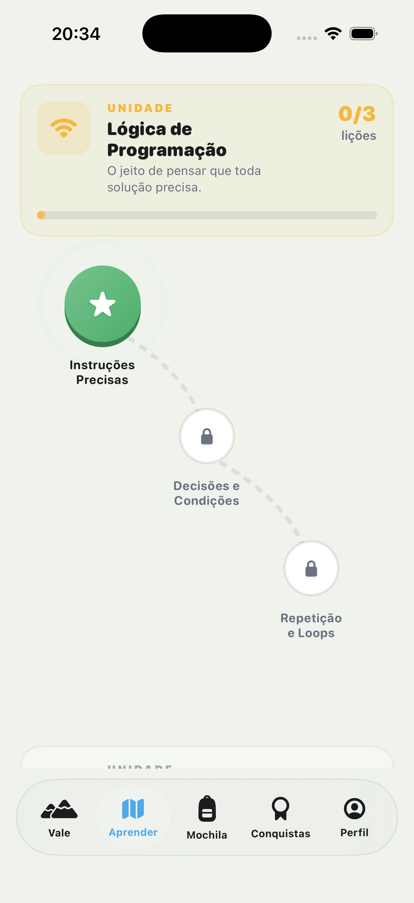 | 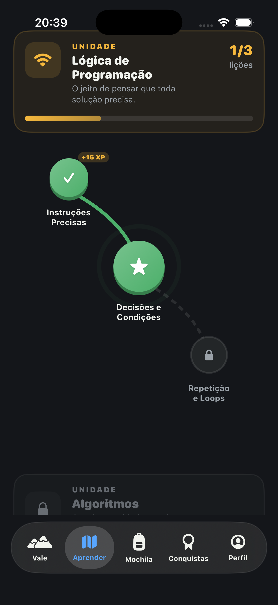 |

| Exercício (Light) | Exercício (Dark) |
|:---:|:---:|
| 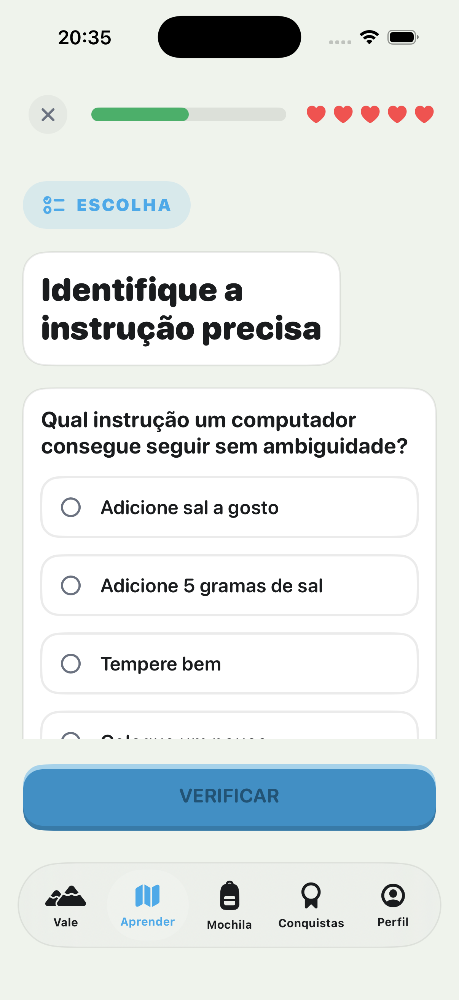 | 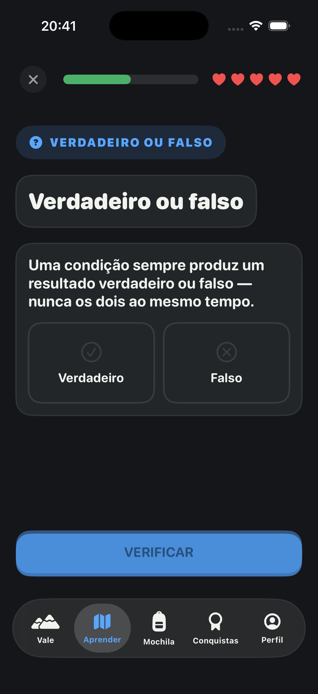 |

| Lição concluída (Light) | Lição concluída (Dark) |
|:---:|:---:|
| 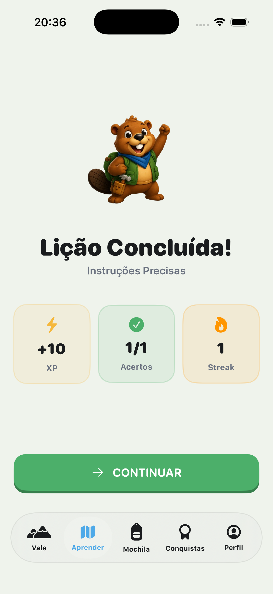 | 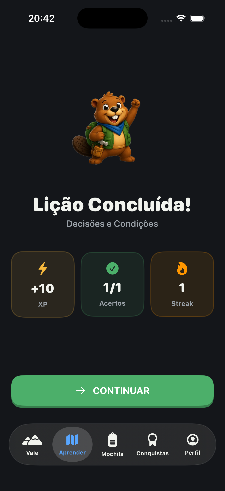 |

### Progresso, perfil e revisão

| Conquistas (Light) | Conquistas (Dark) |
|:---:|:---:|
| 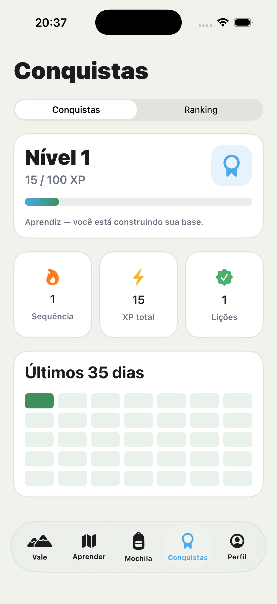 | 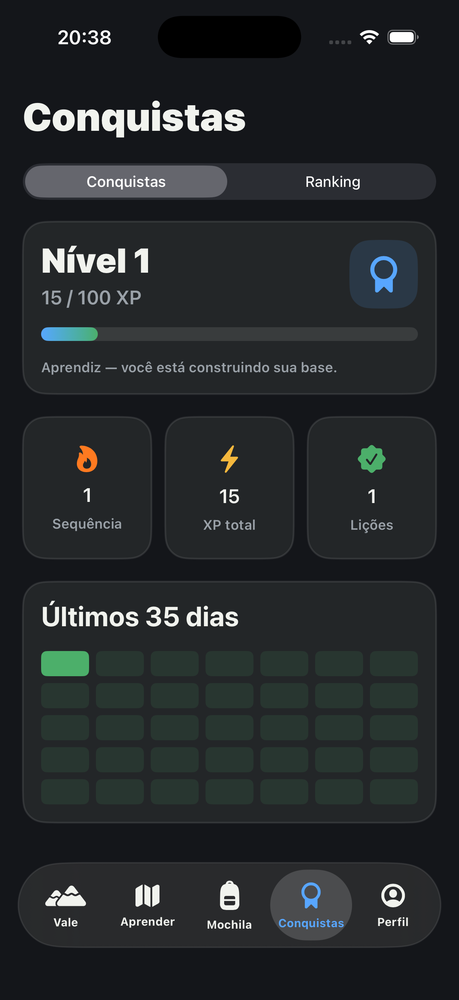 |

| Perfil (Light) | Perfil (Dark) |
|:---:|:---:|
| 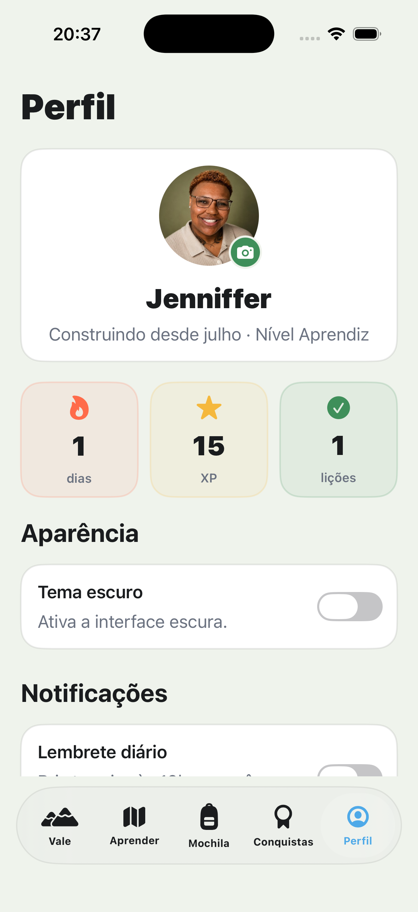 | 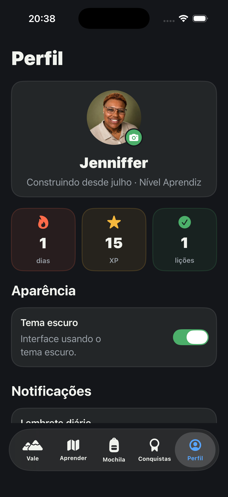 |

| Agenda de revisões (UIKit) | Boas-vindas | Feedback de acerto |
|:---:|:---:|:---:|
| 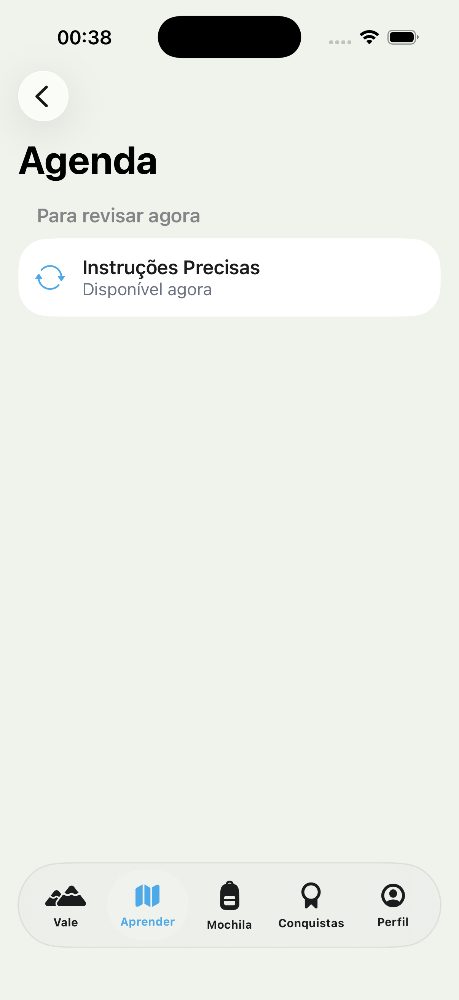 | 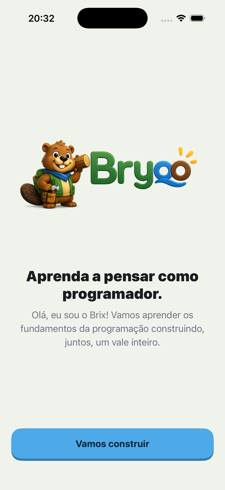 | 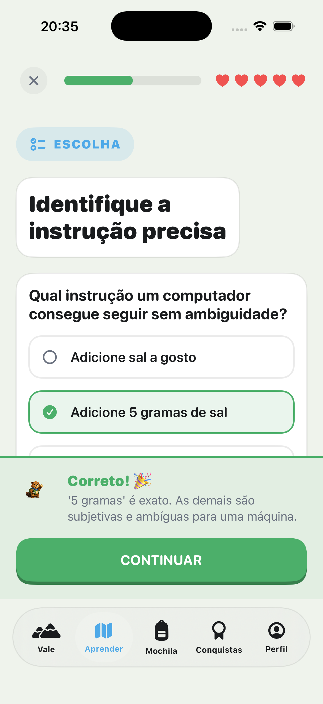 |

---

## ✨ Funcionalidades

- 🗺️ **Trilha de aprendizado** em formato de mapa, com lições que desbloqueiam em sequência.
- 📚 **Lições multi-passo**: história, conceito, escolha única, verdadeiro/falso, ordenação, complete-o-código, "pense como a máquina" (rastreio de variáveis) e um playground interativo de busca binária.
- 🔁 **Revisão espaçada (SM-2)**: lições concluídas voltam para revisão em intervalos crescentes, de acordo com o desempenho.
- 📅 **Agenda de revisões**: mostra o que pode ser revisado agora e quando cada lição volta.
- 🎮 **Gamificação completa**: XP, níveis, corações (vidas), sequência (streak), conquistas e materiais colecionáveis.
- 🔥 **Proteção de sequência** (streak freeze) e **regeneração de corações** ao longo do tempo.
- 🎯 **Meta diária** configurável (Casual · Regular · Sério · Intenso).
- 🏔️ **Vale do progresso**: uma cena que evolui com o avanço da pessoa.
- 🧩 **Widget** de sequência e meta diária, que abre o app direto nas revisões do dia.
- 🔗 **Deep links** (`bryqo://review`, `bryqo://learn`).
- 👤 **Onboarding** conversacional em 7 passos com o mascote Brix.
- ☁️ **Sincronização em nuvem** com login anônimo, **Sign in with Apple** ou **Google**; a conta vinculada mantém o mesmo progresso.
- 🔔 **Lembrete diário** local para manter o hábito.
- 🌗 **Light / Dark mode** e **acessibilidade** (Dynamic Type, VoiceOver, Reduce Motion, háptica).

---

## 🛠 Tecnologias

| Camada | Tecnologia |
|---|---|
| **Linguagem** | Swift 6 (modo de linguagem com checagem estrita de concorrência) · `async/await`, `@MainActor` por padrão, `Mutex` |
| **Interface** | SwiftUI · UIKit (View Code, `UICollectionView`, diffable data source) |
| **Estado** | Observation framework (`@Observable`) |
| **Navegação** | `NavigationStack(path:)` com rotas tipadas · deep links por URL scheme |
| **Persistência local** | **SwiftData** (`@Model`, `ModelContainer`) com migração de schema versionada (V1 → V6), `#Predicate`, `@Query`, `#Unique` e `#Index` |
| **Backend / nuvem** | **Firebase**: Auth, Firestore, Analytics, Crashlytics |
| **Autenticação** | Firebase Auth anônimo, vinculado depois a **Sign in with Apple** (`AuthenticationServices` + `CryptoKit`) ou **Google Sign-In** (SPM `GoogleSignIn-iOS`) |
| **Extensões** | WidgetKit (App Group para compartilhar dados com o app) |
| **Notificações** | `UserNotifications` (lembrete diário local) |
| **Dependências** | Swift Package Manager: `firebase-ios-sdk`, `GoogleSignIn-iOS` e o pacote local `BryqoDomain` |
| **Testes** | **Swift Testing** (`@Test`, `@Suite`, testes parametrizados) |
| **CI/CD** | **Fastlane** + **GitHub Actions** |

---

## 🏗 Arquitetura

O Bryqo segue **MVVM** com uma **camada de estado central observável** (`BryqoAppState`) como fonte única da verdade. As regras de domínio que não dependem de UI nem de persistência vivem em um **pacote Swift separado**, e a navegação é coordenada por um **roteador** fora das Views.

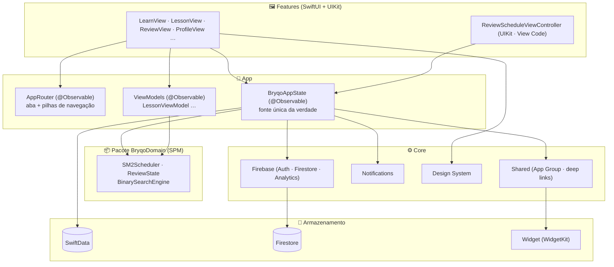

### Decisões arquiteturais

| Decisão | Por quê | Trade-off |
|---|---|---|
| **Estado central único** (`BryqoAppState`) | Coordena SwiftData ↔ Firestore, gamificação, streak e widget em um só lugar, com `@Observable` | O arquivo cresce; o próximo passo é extrair uma camada de repositório |
| **Um modelo por camada** | `UserProgress` (memória), `PersistedUserState` (`@Model`) e `FirestoreUserSnapshot` (DTO) evoluem de forma independente | Exige mapeamento explícito entre os tipos |
| **Pacote `BryqoDomain`** | Algoritmos puros (SM-2, busca binária) compilam e são testados sem simulador; o pacote não conhece SwiftUI, SwiftData nem Firebase | Tipos públicos exigem `public` e `Sendable` explícitos |
| **Roteador fora das Views** | A pilha de cada aba sobrevive à troca de abas, e deep links viram uma simples mudança de estado | Destinos centralizados em `LearnRoute` |
| **Injeção de dependência pelo inicializador** | `BryqoAppState(inMemory:)` e funções com `now`/`calendar` injetados deixam os testes determinísticos | Parâmetros a mais nas assinaturas |
| **Swift 6 com `MainActor` por padrão** | Data races viram erro de compilação; delegates e callbacks viram `async/await` com uma continuação que só retoma uma vez (`OneShotContinuation`) | Tipos usados fora da main thread (modelos de domínio, cores dinâmicas, monitor de rede) precisam ser marcados `nonisolated` |
| **Foto de perfil num `actor`** | `AvatarStore` é o único dono do arquivo; a redução (ImageIO, até 512 px) roda em uma função `@concurrent`, e `.task(id:)` cancela a foto anterior. 4,1 MB → 135 KB no disco e −50 MB de memória no Perfil | Reentrância: o actor confere, depois do `await`, se uma foto mais nova não chegou antes de gravar |
| **`ProfileModel` separado da `ProfileView`** | A View só desenha e repassa toques; vínculo de conta, loading, erro, backup e textos ficam num `@Observable` testável, com a conta (Firebase) atrás do protocolo `AccountLinking`. 22 → 0 acessos ao estado global na View, e o fluxo de vínculo ganhou testes | Mais um arquivo por tela; vale quando a tela tem decisões, não para Views só de layout |
| **Lembrete com dependências injetadas** | `BryqoNotificationManager` recebe o centro de notificações (protocolo `NotificationScheduling`), o calendário e o relógio; `BryqoAppState` recebe o `UserDefaults`. Os testes usam um centro falso e qualquer data, e acharam o bug do "dia 32": no último dia do mês o lembrete de amanhã nunca disparava | Mais parâmetros no `init`; todos têm o valor real como padrão, então o app não muda |
| **Corações cobrados pelo `LessonViewModel`** | O ViewModel recebe `loseHearts: (Int) -> Void` e informa quantos corações perdeu de uma vez. Antes, a `LessonView` repassava a perda num `onChange(of: hearts)`, que roda uma vez por mudança: um passo com 3 erros tirava 3 corações na lição e 1 no app | Uma closure a mais no `init`, com padrão vazio, então os testes antigos não mudam |
| **UIKit onde faz sentido** | Listas com seções e atualizações animadas são naturais em `UICollectionView` com diffable data source | Exige uma ponte (`UIViewControllerRepresentable`) |

---

## 🌐 Conteúdo remoto (API)

As lições vêm de um **catálogo JSON** ([`content/catalog.json`](content/catalog.json)) publicado neste repositório e servido pelo GitHub. Assim, uma lição pode ser corrigida ou adicionada sem publicar uma versão nova na App Store.

```
API (JSON) → HTTPClient (URLSession) → DTO Decodable → mapeamento + validação → LearningUnit/Lesson → ContentRepository (@Observable) → Views
```

- **`HTTPClient`**: protocolo com uma implementação em `URLSession` (async/await). Os testes usam um cliente falso, sem rede.
- **`ContentService`**: monta a requisição com tempo limite e `If-None-Match`, e trata cada resposta: `200` decodifica o catálogo, `304` significa "nada mudou", outro status é erro.
- **DTOs separados dos models**: os structs `Decodable` espelham o JSON; o mapeamento para os models do app valida o conteúdo. Uma lição com um passo inválido é descartada; tipos de passo desconhecidos (enviados por um servidor mais novo) não derrubam a decodificação.
- **Offline-first**: o app abre com o último catálogo salvo ou, se nunca houve conexão, com o conteúdo que vem dentro dele (`BryqoContent`). A atualização roda em segundo plano na abertura e ao voltar para o primeiro plano, e nunca troca o conteúdo por uma versão mais antiga ou vazia.
- **Cache com ETag**: o catálogo e o ETag ficam em disco; se nada mudou, o servidor responde `304` e nada é baixado de novo.
- **Erros tratados por tipo** ([`NetworkFailure`](bryco-app/Core/Networking/NetworkFailure.swift)), nunca como "Erro ao carregar":

  | Falha | Nova tentativa | Quem fica sabendo |
  |---|---|---|
  | Sem internet | Quando a conexão volta (`NWPathMonitor`) | Ninguém: o app funciona offline |
  | Tempo esgotado | Sim, espera crescente (1 s, 2 s…) com variação aleatória | Ninguém, se recuperar |
  | 5xx, 408 | Sim, espera crescente | Crashlytics, se todas falharem |
  | 429 | Sim, respeitando o `Retry-After` | Crashlytics, se todas falharem |
  | 4xx | Não | Crashlytics |
  | JSON inválido | Não | Crashlytics |
  | Lição inválida no catálogo | — (só ela é descartada) | Crashlytics, com o id da lição |

  A única coisa que a pessoa vê é um aviso discreto na trilha se o app passar 7 dias sem conseguir falar com o servidor.
- **Catálogo sempre em sincronia**: um teste garante que o JSON publicado é idêntico ao conteúdo embutido. Para regenerá-lo depois de editar `BryqoContent`, rode os testes com `TEST_RUNNER_BRYQO_WRITE_CATALOG=1`.

---

## 🧭 Navegação e deep links

A navegação vive no [`AppRouter`](bryco-app/App/AppRouter.swift), um objeto `@Observable` que guarda a aba selecionada e uma pilha de rotas tipadas ([`LearnRoute`](bryco-app/App/LearnRoute.swift)) para cada aba com navegação.

- **A pilha sobrevive à troca de abas**: como o estado não fica dentro das Views, a pessoa troca de aba e volta exatamente onde estava.
- **A barra de abas some durante a lição**: o roteador sabe quando uma lição está no topo da pilha da aba visível.
- **Destinos centralizados**: `learnRouteDestinations(appState:)` registra todas as telas que podem ser empilhadas.

| Deep link | Efeito |
|---|---|
| `bryqo://review` | Seleciona a aba Aprender e abre a tela de revisão (usado pelo widget) |
| `bryqo://learn` | Seleciona a aba Aprender e volta a trilha para o início |

```bash
# testar no simulador
xcrun simctl openurl booted "bryqo://review"
```

---

## 🧱 Interoperabilidade com UIKit

A **Agenda de revisões** ([`ReviewScheduleViewController`](bryco-app/Features/Review/ReviewScheduleViewController.swift)) é escrita em **UIKit com View Code**:

- layout 100% em código com Auto Layout (`NSLayoutConstraint`), sem Storyboard nem XIB;
- `UICollectionView` com layout de lista composicional e **diffable data source**, que anima as mudanças de linhas;
- células configuradas com `UIListContentConfiguration` (suportam Dynamic Type automaticamente);
- estado vazio com `UIContentUnavailableConfiguration`;
- integração no `NavigationStack` do SwiftUI via `UIViewControllerRepresentable`.

A lógica que monta as seções ([`ReviewSchedule.make`](bryco-app/Features/Review/ReviewScheduleItem.swift)) é uma função pura, coberta por testes.

---

## 🎨 Design System

Todo o visual é centralizado em [`BryqoTheme`](bryco-app/Core/DesignSystem/BryqoTheme.swift), garantindo consistência e suporte nativo a light/dark, inclusive na tela UIKit.

### Tokens

| Token | Exemplos |
|---|---|
| **Cores adaptativas** | `background`, `surface`, `primary` (verde), `river` (azul), `sun` (XP), `coral` (streak), cada uma com variante *light* e *dark* via `Color(light:dark:)` |
| **Espaçamento** | `Spacing.xs … xxxl` (4 → 40 pt) |
| **Raio** | `Radius.card` (20) · `Radius.button` (18) · `Radius.pill` |

### Componentes reutilizáveis

| Componente | Descrição |
|---|---|
| `BryqoPrimaryButton` + `Duo3DButtonStyle` | Botão 3D estilo Duolingo que "afunda" ao ser pressionado |
| `BryqoCard` / `.bryqoCard()` | Cartão padrão com borda e cantos contínuos |
| `BryqoStatPill` | Pílula de estatística (XP, streak…) |
| `BrixAvatar` / `BrixSpeechBubble` | Mascote Brix com balão de fala (via `Shape` customizado) |
| `FloatingTabBar` | Barra de navegação flutuante com `matchedGeometryEffect` |
| `.bryqoFont(_:relativeTo:…)` | Fonte de tamanho fixo que **escala com Dynamic Type** (`@ScaledMetric`) |

---

## 💾 Persistência e sincronização

O Bryqo é **offline-first**: todo o progresso funciona sem rede via SwiftData, e a nuvem é uma camada opcional de backup e sincronização.

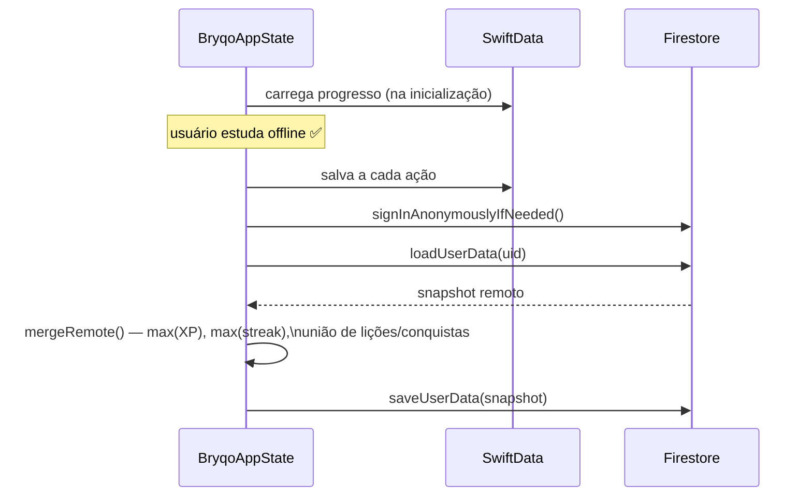

- **Dois modelos `@Model`**: `PersistedUserState` (progresso e perfil, um registro por usuário) e `LessonReview` (um registro por lição em revisão espaçada, com `#Unique` em `lessonId` e `#Index` em `nextReviewAt`). Veja [`PersistedUserState.swift`](bryco-app/Domain/Models/PersistedUserState.swift).
- **Consultas no banco**: as revisões vencidas vêm de um `FetchDescriptor` com `#Predicate` (`nextReviewAt <= agora`) e `SortDescriptor`; o aviso da trilha usa `fetchCount`, sem carregar as linhas; as telas de Revisão e Agenda usam `@Query`, sobre o mesmo `mainContext` do app.
- **Migração de schema versionada**: 6 versões (`BryqoSchemaV1…V6`). Os estágios até a V5 são *lightweight*; a V6 tem uma etapa personalizada que lê as revisões guardadas como JSON na V5 e cria uma linha `LessonReview` para cada uma. A migração é testada com um banco V5 real gravado em disco.
- **Merge sem perda de progresso**: campos numéricos usam `max()` e coleções usam união de conjuntos.
- **Sem bloqueio de rede**: se o login falhar, o app continua funcional com os dados locais.
- **Voltar para a rede sem destruir nada**: a leitura do backup distingue três casos (encontrado, não existe e "não deu para saber"). Só um "não existe" confirmado pelo servidor cria o backup a partir do progresso local, e o app só espelha gravações na nuvem depois de se reconciliar com ela na sessão. Assim, um app reinstalado e aberto sem internet nunca sobrescreve o backup com progresso vazio. A sincronização roda na abertura e sempre que o app volta ao primeiro plano.
- **Falhas nunca são silenciosas**: erros ao abrir, ler ou salvar o banco são registrados no Crashlytics. Se o banco não abrir (por exemplo, numa migração com erro), o app continua usável num armazenamento temporário e mostra um aviso de que o progresso não será guardado ao fechar.
- **Widget**: a cada mudança de progresso, o app grava um espelho pequeno (`BryqoWidgetSnapshot`) no App Group; o widget lê só esse espelho, nunca o SwiftData ou o Firestore.

---

## 🎮 Gamificação

| Sistema | Regra |
|---|---|
| **XP e níveis** | Limiares `[0, 100, 250, 500, 1000, …]`; nomes por nível: Aprendiz → Estudante → Desenvolvedor → Arquiteto → Engenheiro |
| **Corações (vidas)** | Máximo de 5; erro consome 1; **regenera +1 a cada 30 min**; lição perfeita devolve 1 |
| **Sequência (streak)** | +1 por dia consecutivo; marcos em 7/30/100 dias; **streak freeze** protege 1 dia perdido automaticamente |
| **Revisão espaçada** | SM-2: 0 erros → qualidade 5; 3+ erros → a lição volta no dia seguinte; intervalos crescem com o fator de facilidade |
| **Conquistas** | 10 conquistas (comum · rara · épica) por lições, XP, streak e perfeição |
| **Meta diária** | Casual (15 XP) · Regular (30) · Sério (50) · Intenso (75) |

---

## ♿ Acessibilidade

O app foi auditado com base nas **Human Interface Guidelines** da Apple:

- **Dynamic Type**: todo texto escala com a preferência do usuário via `.bryqoFont` (`@ScaledMetric`); a tela UIKit usa estilos de texto do sistema.
- **Áreas de toque de 44 pt** em botões de ícone.
- **VoiceOver**: rótulos em botões de ícone e imagens; corações anunciados como "Vidas: N de 5"; imagens decorativas ocultas.
- **Reduce Motion**: animações contínuas (confete, mascote flutuante, cena do vale) são desativadas quando o usuário pede menos movimento.
- **Háptica**: `.sensoryFeedback` em acertos, erros, conclusão de lição e marcos de sequência.
- **Diferenciação sem depender só de cor**: estados de certo/errado sempre combinam cor com ícone e texto.

---

## 🧪 Testes

**162 testes** escritos com **Swift Testing** (`@Test`, `@Suite`, testes parametrizados): 149 no app e 13 no pacote `BryqoDomain`.

| Suite | Cobre |
|---|---|
| `SM-2 scheduler` *(pacote)* | Mapeamento de erros para qualidade, intervalos 1 → 6 → n dias, lapsos e piso do fator de facilidade |
| `Binary search engine` *(pacote)* | Cálculo do meio, estreitamento da janela, alvo encontrado e janela esgotada |
| `BryqoAppState gamification` | Streak (incremento, decay, freeze), regeneração de corações, merge com Firestore, níveis e meta de XP |
| `Review scheduling` | Agendamento após a lição, uma linha por lição, revisões vencidas ordenadas no banco e exclusão |
| `Review migration V5 → V6` | Banco V5 real em disco migrado para V6: cada revisão do JSON vira uma linha, com todos os campos |
| `Review schedule` | Seções "agora" e "próximas", ordenação e rótulos de data da agenda |
| `App router` | Deep links, URLs desconhecidas, pilha preservada entre abas e visibilidade da barra de abas |
| `LessonViewModel` · `BinarySearchViewModel` · `VariableTraceViewModel` | Seleção, verificação, corações, XP e progressão de passos |
| `Persistence health` | Banco que não abre (fallback em memória com aviso e registro do erro) e mensagens do aviso |
| `Offline sync` | Backup indisponível não grava nada, backup ausente é criado, backup existente é mesclado, e nada vai para a nuvem antes da reconciliação |
| `Content catalog` · `Content service` · `Content repository` · `Network error handling` | JSON publicado igual ao conteúdo embutido, validação de lições, status 200/304/erro, ETag, cache, fallback offline, backoff, Retry-After, espera pela conexão e o que é reportado |
| `Account link state` · `Profile model` | Estados do vínculo com Apple e Google (cancelamento não é erro), sucesso com backup, falha sem backup, progresso só no botão escolhido, toque duplo ignorado, tema e textos do Perfil |
| `Daily reminder` | Lembrete às 19h, "amanhã" na virada de mês, ano e 29 de fevereiro, sem lembrete duplicado, permissão negada desliga o toggle e concluir uma lição move o lembrete |
| `Lesson hearts` | Acerto não cobra coração; cada erro cobra um; um "Pense como a máquina" com vários erros cobra todos de uma vez; a lição para sem corações só depois do feedback; o app termina com os mesmos corações que a lição mostra |
| `Onboarding outcome` · `Profile stats` | Resultado do onboarding, níveis, contagem de lições e streak em risco |

Os testes usam um **banco SwiftData em memória** (`BryqoAppState(inMemory:)`) e datas/calendário injetados, então cada caso parte de um estado limpo e é determinístico.

```bash
# pacote de domínio (rápido, sem simulador)
cd Modules/BryqoDomain && swift test

# testes do app
xcodebuild test \
  -project bryco-app.xcodeproj \
  -scheme bryco-app \
  -destination 'platform=iOS Simulator,name=iPhone 17' \
  -only-testing:bryco-appTests

# tudo de uma vez, como no CI
bundle exec fastlane test
```

---

## 🚦 CI/CD

O pipeline é definido no [`Fastfile`](fastlane/Fastfile) e executado pelo [GitHub Actions](.github/workflows/ci.yml) a cada push na `main` e em todo pull request.

| Lane | O que faz |
|---|---|
| `fastlane test` | Roda `swift test` no pacote `BryqoDomain` e os testes unitários do app no simulador (gera relatório JUnit e `.xcresult`) |
| `fastlane build` | Compila o app para o simulador, sem assinatura de código |
| `fastlane ci` | `test` + `build`, o que o GitHub Actions executa |

- A versão do Fastlane é fixada pelo `Gemfile.lock`.
- O `GoogleService-Info.plist` real fica fora do Git. No CI, o workflow usa um [arquivo de exemplo](ci/GoogleService-Info.plist) com valores falsos, só para o app iniciar durante os testes.
- Os resultados dos testes ficam disponíveis como artefato de cada execução.

---

## 📁 Estrutura de pastas

```
bryco-app/
├── App/                    # Entrada do app, MainTabView, BryqoAppState, AppRouter, LearnRoute
├── Core/
│   ├── DesignSystem/       # BryqoTheme, ScaledFont (Dynamic Type)
│   ├── Firebase/           # Auth, Firestore, Analytics
│   ├── Notifications/      # Lembrete diário local
│   └── Shared/             # Código compartilhado com o widget (snapshot, deep links)
├── Domain/
│   └── Models/             # Lesson, Exercise, UserProgress, PersistedUserState (@Model)
├── Features/               # Uma pasta por tela
│   ├── Onboarding/  LearningPath/  Lesson/  Review/
│   ├── Achievements/  Profile/  Backpack/  Valley/  Progress/
└── Resources/
    └── Content/            # BryqoContent: 12 unidades, 41 lições
BryqoWidget/                # Extensão WidgetKit
Modules/
└── BryqoDomain/            # Pacote SPM local: SM-2 e busca binária, com testes próprios
bryco-appTests/             # Suites Swift Testing do app
fastlane/                   # Lanes de teste, build e CI
.github/workflows/          # Pipeline do GitHub Actions
ci/                         # Configuração de exemplo usada no CI
docs/screenshots/           # Capturas light e dark
```

---

## 🚀 Como rodar

### Pré-requisitos

- macOS com **Xcode 26.5+**
- Simulador ou dispositivo com **iOS 26.5+**
- Ruby + Bundler (apenas para as lanes do Fastlane)

### Passos

```bash
# 1. Clonar
git clone https://github.com/jenniffermartinsf/bryqo-app.git
cd bryqo-app

# 2. Configurar o Firebase (escolha uma opção)
#    a) com seu projeto Firebase: copie o seu GoogleService-Info.plist para bryco-app/
#    b) sem Firebase: use o arquivo de exemplo (o app roda offline, sem sincronização)
cp ci/GoogleService-Info.plist bryco-app/GoogleService-Info.plist

# 3. Abrir no Xcode (as dependências SPM resolvem automaticamente)
open bryco-app.xcodeproj
```

4. Selecione o scheme **bryco-app** e um simulador, e rode com **⌘R**.

> Para usar a nuvem, habilite no Firebase Console **Authentication** (Anônimo, Apple e Google) e crie o banco do **Firestore**, com regras que deixem cada usuário ler e gravar só o próprio `users/{uid}`. O login com Google também precisa do `REVERSED_CLIENT_ID` do seu `GoogleService-Info.plist` como URL scheme em `bryco-app-Info.plist`. Com o arquivo de exemplo, o progresso fica salvo localmente via SwiftData.

Para rodar as lanes do Fastlane:

```bash
bundle install
bundle exec fastlane ci
```

---

## 🗺 Roadmap

- [x] Widget de sequência (WidgetKit)
- [x] Revisão espaçada (SM-2) e agenda de revisões
- [x] Navegação com roteador, pilhas por aba e deep links
- [x] Pacote de domínio (SPM) e pipeline de CI com Fastlane
- [ ] Extrair uma camada de repositório do `BryqoAppState`
- [ ] Extrair `OnboardingViewModel` para testar a navegação do wizard
- [ ] Testes de UI de acessibilidade (XCUITest validando rótulos de VoiceOver)
- [ ] Sincronização em tempo real (listeners do Firestore)
- [ ] Lane de distribuição para TestFlight

---

## 👩‍💻 Autoria

Desenvolvido por **Jenniffer Martins** · [LinkedIn](https://www.linkedin.com/in/jennifferlinof) · [GitHub](https://github.com/jenniffermartinsf)

Mascote **Brix** 🦫 e identidade visual **Bryqo**: construindo fundamentos, um bloco por vez.
